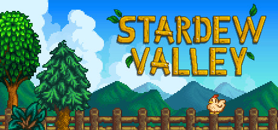

**Stardew Valley by ConcernedApe (2016) is the definitive indie farming RPG.**

---

## 📖 About

Stardew Valley by ConcernedApe (2016) is the definitive indie farming RPG. You inherit a farm and rebuild it while befriending villagers, mining, and exploring. The game is relaxing in early hours but community center completion and perfection achievements demand encyclopedic planning.

## ⚠️ Problems Without Trainer

| Problem | Status |
|---------|--------|
| Perfection achievement requires meeting every villager at precise event times | ✅ Solved |
| Community center bundle items only available in certain seasons per year | ✅ Solved |
| Skull Cavern depths require hundreds of bomb and food consumables | ✅ Solved |
| Qi challenges lock behind completing game content in specific order | ✅ Solved |
| Speed upgrades for tools require repeated trips to blacksmith across seasons | ✅ Solved |

## ✅ Solution

The **Stardew Valley Trainer** solves all these issues, giving you complete control so you can focus on enjoying the game.

## 🎯 Features

- Unlimited Resources / Currency
- God Mode / Invincibility
- Instant Skill & Ability Cooldown
- One-Hit Kill
- Freeze Timers
- Unlock All Items & Achievements
- Custom Speed Multiplier
- Infinite Stamina / Energy

## 🚀 Quick Start

1. **Disable Windows Defender** temporarily (trainer may trigger false positive)
2. Get the trainer from the button above
3. Launch Stardew Valley
4. Run the trainer as Administrator
5. Use the hotkeys to activate cheats in-game

## 💎 Free vs Pro

| Feature | Free | Pro |
|---------|------|-----|
| God Mode | ✅ | ✅ |
| Unlimited Resources | ✅ | ✅ |
| Advanced Cheats | ❌ | ✅ |
| Auto-Updates | ❌ | ✅ |
| Priority Support | ❌ | ✅ |

## 💻 Requirements

- Windows 10 / 11 (64-bit)
- Stardew Valley (any version)
- .NET Framework 4.8+
- DirectX 11+

## 🍎 macOS

## ⚖️ Legal

Educational and single-player use only.

---

